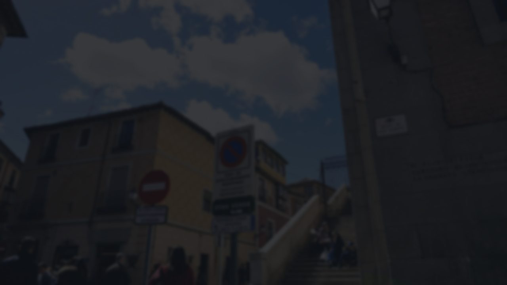

# dsh-wallpaper

给 **DeepSeek Harness** Web GUI 换壁纸的插件：图片、视频、跟随系统桌面壁纸，
全部在一个面板里切换，透明度/暗度/填充方式都能调。

DSH 本身没有壁纸设置（设置 → 通用 → 外观只有浅色/深色/跟随系统、字号和字体），
这个包走它自己的插件机制，并自带一个浮在右下角的控制面板。



> 上图是画布区域按默认参数合成出来的底色示意，不是完整界面截图。
> 想换成真实截图，把图片放进 `docs/` 再改这一行即可。

## 功能

- **壁纸按钮组**：内置两张（街景 / 党徽）+ 导入的图片和视频，点一下应用，再点同一个取消
- **跟随桌面壁纸**：单独一行，点一次现读 Windows 当前桌面壁纸
- **悬停出现 ×**：导入的删除，内置的隐藏（可一键恢复）
- **透明度**：一个滑杆同时管侧栏外框和聊天列
- **图片暗度**：压亮图，保文字可读性
- **画面填充**：填充（裁边）/ 适应（留边），图片和视频都适用
- 面板点空白处或按 `Esc` 自动关闭

选择存在 `localStorage`，导入的图片/视频存在 `IndexedDB`，都在本机浏览器里，
不上传、不进模型上下文。

## 安装

前提：已经装好 DeepSeek Harness（桌面版或 `dsh web` 均可）。

1. 侧栏点 **插件** → 右上 **添加插件** → **安装第三方插件**
2. 粘下面任意一种：

   ```
   https://github.com/strugglejin/dsh-wallpaper
   ```

   或者本机目录：

   ```
   D:\dsh-wallpaper
   ```
3. 安装完成后**重启** DeepSeek Harness（组合包的 patch 只在启动时读取）

装好后右下角（输入框上方）会出现「🖼 壁纸」按钮。

> 从 Git 地址安装时 pnpm 会拷一份快照，之后上游更新需要卸载重装；
> 从本地目录安装是 `link:`，改文件重启即可生效，但**不要挪动那个目录**。

## 使用

| 控件 | 说明 |
|---|---|
| 壁纸按钮 | 点一下应用，再点同一个取消 |
| 悬停出现的 × | 导入的：真删除；内置的：隐藏，下方给「恢复内置壁纸」 |
| 跟随桌面 | 单独一行，读系统壁纸；没有 × |
| 透明度 | 5–100%，越小图越明显（70 淡 / 52 中 / 34 浓） |
| 图片暗度 | 0–90% |
| 画面填充 | 折叠项，填充/适应 |
| ＋ 导入图片 / 视频… | 图片缩到长边 2560 存 JPEG，视频按原文件存 Blob；**最多 4 个，超出自动淘汰最旧的** |

## 它是怎么工作的（以及踩过的坑）

这个插件同时是 **bundle** 和 **plugin**，patch 里那一行的包名就是它自己。四个坑值得记下来：

1. **`link:` 不装依赖。** 拆成两个包（bundle 引用 plugin）时，安装只会链接被指定的那个，
   另一个永远不会进 profile 的解析表 → 启动失败。正解是一个包身兼两职。
2. **组合包本身不是行。** `dsh-app-boot` 只把 bundle 当 patch 提供者，行为必须放在
   patch 插入的那一行里。
3. **`dsh.client.immediately` 必须为 `true`。** 客户端插件默认惰性：bundle 只注册 factory，
   模块体要等"第一次被使用"才执行。没有这个开关 `apply()` 永远不跑，而且**不报任何错**。
4. **铺满整屏的是 `--dsw-specific-sidebar-fill`，不是 `--dsw-alias-bg-base`。**
   Windows 自定义标题栏那条 `.BynINW_frame` 规则用它做背景（浅色 `#f9fafb` / 深色 `#1b1b1c`，
   完全不透明）。只改 `bg-base` 时图片会被整个盖住——表现是"启动时闪一下"。

透明度的分工：`sidebar-fill` = 画布/侧栏，`bg-base` = 正文列，`bg-layer-*` = 卡片。
视频另走一条路：页面里挂 `position:fixed; object-fit:cover` 的 `<video>`（`z-index:-2`），
蒙版 `-1`，靠上面那套透明 token 才看得见。

「跟随桌面」由 Host 半侧提供：注册 `GET /_dsh-wallpaper/desktop`，优先读
`%APPDATA%\Microsoft\Windows\Themes\TranscodedWallpaper`，回落到注册表
`HKCU\Control Panel\Desktop\WallPaper`。页面用同源 fetch 取（桌面窗口的 origin 是
`dsh-app://app`，Electron 会把 `/assets` 之外的路径带 cookie 转发给本机 Host）。

**它会跟着系统壁纸一起变**：选中「跟随桌面」时，页面每 **60 秒**带 `If-None-Match`
问一次，切换回窗口时也会立刻问一次；Host 用「文件大小 + 修改时间」生成 `ETag`，
没变就回 `304`，所以轮询在壁纸不变时只花响应头。Windows 的幻灯片/主题切换会重写
`TranscodedWallpaper`，因此能在 1 分钟内反映到面板里。离开「跟随桌面」后轮询停止，
插件卸载时定时器一并清理。

## 自己构建

`lib/client.js` 是生成物，两张内置壁纸会被内联进去：

```
node src/build.mjs                        # 用默认参数
node src/build.mjs --default street --opacity 55 --dim 0.25
node src/selftest.mjs                     # 离线自检
```

参数：`--default street|poster|off`、`--opacity 5..100`、`--dim 0..0.9`。

换成自己的内置图：

```
python scripts/prepare_image.py "D:\图片\xxx.jpg" assets/bg-street.jpg --width 2560 --blur 6 --scale 0.9
node src/build.mjs --default street
```

需要 Python + Pillow（可选，只用于预处理源图）。提交时 **`lib/` 要一起提交**，
这样别人安装时不用构建。

## 已知限制

- **只支持 Windows** 的"跟随桌面"：macOS / Linux 上该按钮会提示读取失败，其他功能正常。
- 视频不转码不裁切，4K 视频会明显吃 GPU。
- 导入的图片/视频存在浏览器里，换浏览器或清缓存就没了。
- 面板是浮层，没有做进 DSH 设置页（那需要 React 与 slot 注册）。
- 部分浮层/菜单用固定色而不是 token，保持不透明——否则菜单和正文会糊成一片。

## License

MIT

